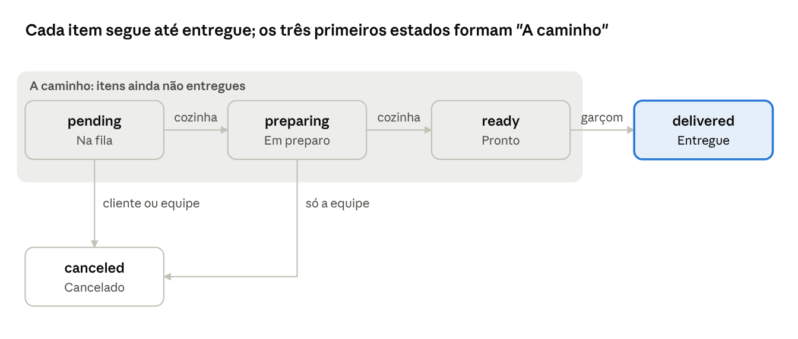
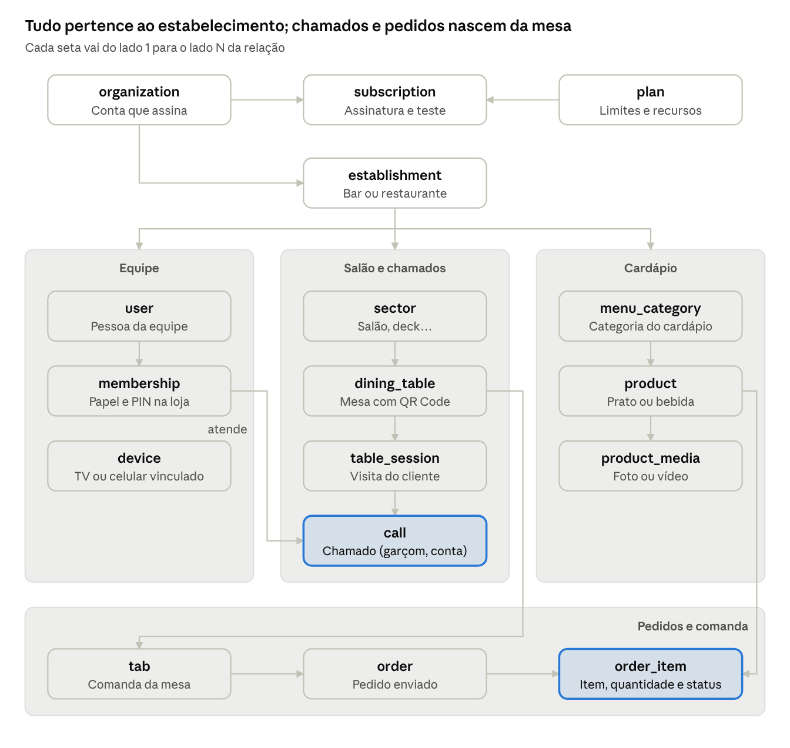
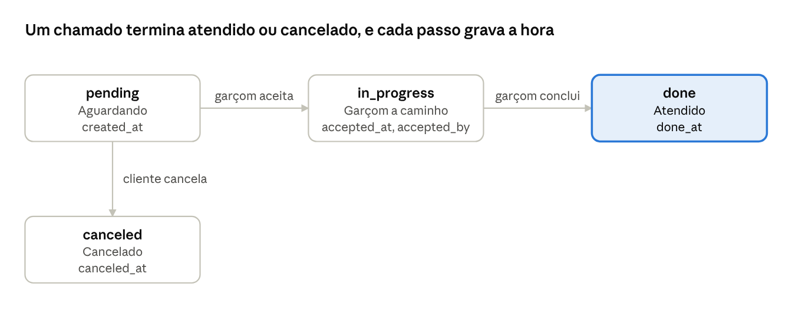
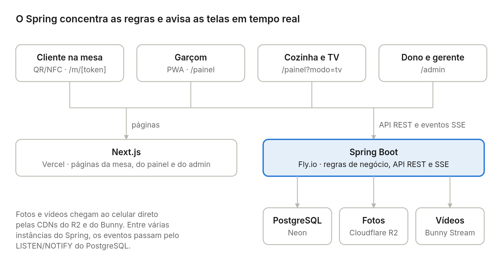
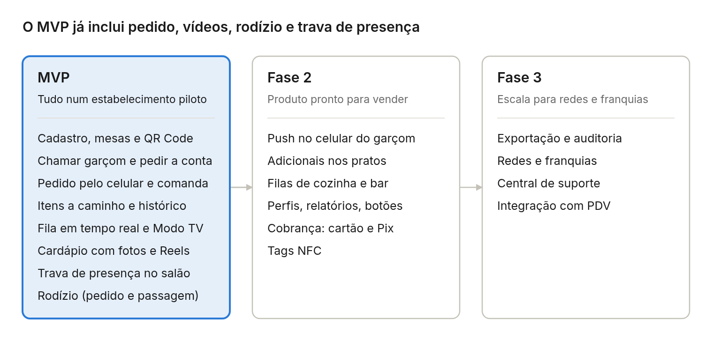

# Especificação — Cardápio Digital (nosso sistema)

21/10/2026 · Fabio Leite Morais

> Este arquivo descreve **apenas o nosso sistema**. O que foi levantado sobre o concorrente que serviu de inspiração (vídeo, funcionalidades e preços do Chamaii) está em [referencia-chamaii.md](referencia-chamaii.md).

## Visão geral

Um SaaS para bares e restaurantes que liga a mesa do cliente à equipe. O cliente escaneia o QR Code da mesa, sem baixar app e sem login, e pode chamar o garçom, ver o cardápio com fotos e vídeos, **fazer pedidos pelo celular**, acompanhar o que ainda não chegou e pedir para fechar a conta. A equipe recebe tudo em tempo real, com alerta sonoro, no celular e numa TV da cozinha ou do salão.

**Público-alvo.** Restaurantes, bares, pubs, cafeterias, pizzarias, japoneses, churrascarias e outros rodízios, de 20 a mais de 100 mesas.

**Usuários do sistema:**

| Usuário | Onde usa | O que faz |
| --- | --- | --- |
| Cliente da mesa | Navegador do celular (via QR Code ou NFC) | Chama o garçom, vê o cardápio, faz pedidos, acompanha os itens, pede para fechar a conta |
| Garçom | Celular (PWA) | Atende chamados, libera mesas, entrega itens, fecha comandas |
| Cozinha / bar | TV ou tablet (Modo TV) | Vê a fila de itens e marca em preparo e pronto |
| Dono e gerente | Painel web | Cadastra mesas, cardápio, rodízios e equipe; configura a trava de presença; vê relatórios |

**Modelo de negócio.** Assinatura mensal ou anual por estabelecimento, cobrada por número de mesas, com 14 dias de teste grátis. Displays físicos (acrílico com QR Code e NFC) são um produto opcional, vendido por fora do sistema.

**Módulos:**

1. **Página da mesa** — QR Code/NFC sem app, trava de presença, chamar garçom, pedir para fechar a conta, cardápio com fotos e Reels, carrinho, "A caminho", histórico e rodízio.
2. **Painel da equipe e Modo TV** — chamados e pedidos em tempo real, alerta sonoro, fila da cozinha, login do garçom por PIN.
3. **Gestão** — setores, mesas e QR Codes, cardápio e mídias, rodízios, equipe, regras de presença e relatórios.
4. **Conta e assinatura** — cadastro self-service, teste grátis, planos e cobrança.

**O que nos diferencia do Chamaii:**

| Recurso | Chamaii | Nosso sistema |
| --- | --- | --- |
| Chamar garçom e pedir a conta | Sim | Sim |
| Cardápio com fotos e vídeos | Sim | Sim |
| Pedido pelo celular, com comanda | Não | Sim |
| Lista "A caminho" e histórico de pedidos | Não | Sim |
| Fila de itens para a cozinha | Não | Sim |
| Rodízio sem preço, com rodadas e cartão verde/vermelho | Não | Sim |
| Taxa por pedido | — | Nenhuma |
| Teste grátis | 10 dias | 14 dias |

## Nossos planos

Aprovados em 21/10/2026. A cobrança é por número de mesas (20, 50 e 100, os mesmos degraus do Chamaii, para o dono comparar lado a lado), com o pedido pelo celular em **todos** os planos e preço cerca de R$ 10 a R$ 20 acima do concorrente. São preços de partida, para validar com os primeiros estabelecimentos.

| Recurso | Essencial | Pro | Business | Enterprise |
| --- | --- | --- | --- | --- |
| Preço mensal | R$ 69,90 | R$ 119,90 | R$ 219,90 | Sob consulta |
| Preço anual (2 meses grátis) | R$ 699 | R$ 1.199 | R$ 2.199 | Sob consulta |
| Mesas | 20 | 50 | 100 | Ilimitadas |
| Usuários da equipe | 5 | Ilimitados | Ilimitados | Ilimitados |
| Chamar garçom, pedir a conta, cardápio com fotos | Sim | Sim | Sim | Sim |
| Pedido pelo celular, comanda, itens a caminho e histórico | Sim | Sim | Sim | Sim |
| Pedidos e chamados | Ilimitados, sem taxa por pedido | Ilimitados | Ilimitados | Ilimitados |
| Vídeos nos pratos (Reels) | Não | Sim | Sim | Sim |
| Adicionais e opções nos pratos | Sim | Sim | Sim | Sim |
| Filas separadas de cozinha e bar | Não | Sim | Sim | Sim |
| Setores do salão | 1 | 3 | Ilimitados | Ilimitados |
| Perfis e permissões | Não | Sim | Sim | Sim |
| Relatórios | Básicos | Avançados (itens mais vendidos, tempos) | Avançados + exportação | Avançados + exportação |
| Histórico | 90 dias | 12 meses | Ilimitado | Ilimitado |
| Várias unidades | Não | Não | Não | Sim |
| Suporte | E-mail | WhatsApp | WhatsApp prioritário | Gerente dedicado |

Por que esses números:

- **Mesas como métrica.** É fácil de entender, cresce com o tamanho do cliente e o mercado já está acostumado a ela.
- **Pedido em todos os planos.** É o diferencial; se ficar só no plano caro, o nosso plano de entrada vira um Chamaii mais caro.
- **Sem taxa por pedido.** É um bom argumento de venda contra plataformas que cobram comissão, e mantém a cobrança previsível para o dono.
- **Vídeo só a partir do Pro.** Armazenar e entregar vídeo é o maior custo variável do sistema; nos planos maiores ele se paga.
- **Histórico de 90 dias no Essencial** (e não 30): com pedidos, o dono quer comparar pelo menos um trimestre de vendas.
- **Teste grátis de 14 dias** em vez de 10: com pedido pelo celular, o estabelecimento precisa de mais tempo para cadastrar o cardápio antes de testar com clientes.
- **Preço de lançamento.** Para os primeiros 10 a 20 clientes, vale um desconto travado (ex.: 30% por 12 meses) em troca de feedback e depoimento.

Os **displays físicos** (acrílico com QR Code e NFC) ficam fora dos planos: são um produto opcional, vendido por fora do sistema. O sistema só gera o arquivo para impressão.

## Pedido pelo celular (nosso diferencial)

O cliente monta o pedido no cardápio e envia da própria mesa; os itens vão para a equipe em tempo real e o cliente acompanha o que ainda não chegou. Entra já no MVP.

Fluxo do cliente:

1. No cardápio, toca em **Adicionar** no prato, escolhe a quantidade e escreve uma observação ("sem cebola").
2. Revisa o **carrinho** e toca em **Enviar pedido**. O pedido entra na comanda da mesa.
3. Na aba **Meus pedidos** vê:
    1. **A caminho** — itens pedidos e ainda não entregues, com o status de cada um.
    2. **Histórico** — todos os itens pedidos na comanda atual, de todos os celulares da mesa: os já entregues e os que ainda faltam chegar, cada um com seu status e horário, mais o total parcial. "A caminho" é só um filtro do histórico, com os itens que ainda não chegaram.
4. Ao **Pedir a conta**, vê o total da comanda e escolhe Pix, cartão ou dinheiro.

Fluxo da equipe:

1. O pedido aparece no painel com alerta sonoro e na TV da cozinha/bar.
2. O pedido vai direto para a fila da cozinha (padrão). Quem preferir pode ligar a confirmação do garçom antes da cozinha.
3. A cozinha marca **em preparo** e **pronto**; o garçom marca **entregue**. O cliente vê cada mudança na hora.
4. Depois do pagamento, o garçom **fecha a comanda** e a mesa fica livre. A comanda fechada vai para o histórico do estabelecimento.

A lista "A caminho" mostra os itens em *pending*, *preparing* ou *ready*. *Pending* significa "na fila da cozinha"; a cozinha marca *preparing* ao começar. Com a confirmação do garçom ligada, o pedido inteiro espera a confirmação antes de os itens entrarem na fila.

Regras do pedido:

- A comanda abre sozinha no primeiro pedido da mesa e junta os pedidos de todos os celulares até ser fechada.
- O preço do item é copiado no momento do envio; mudar o cardápio depois não altera pedidos feitos.
- Item indisponível não pode ser adicionado; se acabar depois do pedido, a equipe cancela o item e o cliente vê o motivo.
- O cliente só cancela um item enquanto ele está na fila (*pending*); depois que a cozinha começa, só a equipe.
- O pagamento não é feito no app: o cliente pede para fechar a conta, o garçom recebe o aviso com o total e a forma escolhida e cobra na mesa (maquininha, Pix do estabelecimento ou dinheiro).
- Cada estabelecimento pode desligar o pedido pelo celular e usar só chamados e cardápio.

### Trava de segurança: só pede quem está no salão

Como o pedido vai direto para a cozinha, o celular só libera chamar e pedir depois de provar que está dentro do estabelecimento. A prova vale para a visita inteira (a sessão da mesa), não pedido a pedido, para não atrapalhar o cliente. São quatro camadas, todas no MVP:

1. **Presença ao abrir a mesa.** Ao escanear o QR, o sistema tenta, nesta ordem:
    1. **Wi-Fi do restaurante** — o IP público do celular bate com o IP cadastrado da internet do estabelecimento. Sem pedir nada ao cliente.
    2. **Localização (GPS)** — o navegador pede permissão uma vez; o celular precisa estar dentro do raio cadastrado (ex.: 100 m) com precisão razoável.
    3. **Liberação pelo garçom** — se as duas falharem (4G com GPS negado, por exemplo), o cliente toca em "Liberar esta mesa" e o garçom aprova com um toque no painel. Vale até a comanda fechar.
2. **Sessão curta e presa à mesa.** A sessão expira após um tempo sem uso (ex.: 2 horas) e quando a comanda fecha. Um QR fotografado e usado depois cai de novo na verificação de presença.
3. **Limites automáticos.** Um pedido acima de um valor ou quantidade configurável (ex.: R$ 300 ou 10 itens) para na confirmação do garçom; há também limite de pedidos por minuto por sessão.
4. **Controle da equipe.** Todo pedido mostra no painel como a presença foi provada (Wi-Fi, GPS ou garçom). A equipe pode bloquear uma sessão e cancelar os itens dela, e pode trocar o QR de uma mesa a qualquer momento.

O estabelecimento configura no painel: IPs da internet do salão, endereço e raio no mapa, e os limites. Sem nada configurado, vale só a liberação pelo garçom, que é o modo mais seguro.

## Rodízio

Na mesa de rodízio, o cliente pede os itens incluídos **sem ver preço**: o rodízio é cobrado por pessoa na comanda, e só o que é à parte (bebidas, sobremesas) mostra preço. É um modo do cardápio, ligado mesa a mesa, disponível em todos os planos.

Como funciona na mesa:

1. O cliente toca em **Quero o rodízio** (ou o garçom ativa direto no painel). O garçom confirma o número de pessoas por faixa (adulto, criança). Quem confirma é a equipe, porque isso define o valor da conta.
2. Com o rodízio ativo, a página da mesa mostra no topo "Rodízio Japonês · 4 pessoas" e o cardápio ganha a aba **Rodízio**: fotos, vídeos, nomes e descrições, sem preço, com botões + e − e o botão **Enviar rodada**.
3. Os itens vão para a cozinha como qualquer pedido, com preço zero na comanda, e aparecem em "A caminho".
4. Bebidas, sobremesas e o que não está incluído continuam nas outras abas, com preço, e somam na comanda.
5. Na conta aparece: pessoas × preço do rodízio + itens à parte.

Por padrão, o rodízio **não tem limite nenhum**: o cliente pede o quanto quiser, e o que pedir a mais é cobrado conforme a política do restaurante. Cada restaurante pode ligar, se quiser, estas regras opcionais:

- Máximo de unidades por item em cada rodada (ex.: 2 por pessoa).
- Limite de itens ainda não entregues por pessoa (ex.: 4), antes de liberar uma nova rodada.
- Tempo mínimo entre rodadas.
- Tempo limite do rodízio (ex.: 2 horas), com aviso ao cliente 15 minutos antes.
- Aviso de taxa de desperdício no topo do cardápio, com texto definido pelo restaurante.

O estabelecimento configura no painel:

- Um ou mais rodízios (ex.: Japonês, Pizza), cada um com tipo, preço por faixa (adulto, criança de 5 a 10 anos…) e por dia e horário (almoço, jantar, fim de semana).
- Os produtos incluídos. Um produto pode ser só do rodízio (não aparece no à la carte) ou dos dois.
- As regras acima.

Dois tipos de rodízio:

| Tipo | Exemplos | Como o pedido funciona |
| --- | --- | --- |
| À la minute | Japonês, pizza, petiscos, massas | O cliente pede rodadas pelo celular; os itens vão para a cozinha |
| Passagem | Churrascaria, galeteria | Os passadores circulam com as carnes. Pelo celular, o cliente pede um corte específico ("picanha mal passada"), que vai para os passadores, e usa o **cartão verde/vermelho digital** para pausar ou voltar a ser servido |

Dados novos:

| Entidade | Principais atributos |
| --- | --- |
| `rodizio` | `establishment_id`, nome, tipo (`a_la_minute`, `passagem`), descrição, regras opcionais, todas vazias por padrão (máx. por item por rodada, máx. itens não entregues por pessoa, intervalo mínimo entre rodadas, tempo limite), aviso de desperdício, ativo |
| `rodizio_price` | `rodizio_id`, faixa (adulto, criança…), preço, dias da semana, horário de início e fim |
| `rodizio_product` | `rodizio_id`, `product_id` (produto incluído) |
| `tab_rodizio` | `tab_id`, `rodizio_id`, ativado por, início, fim previsto, status (`serving`, `paused`, `ended`) |
| `tab_rodizio_guest` | `tab_rodizio_id`, faixa, quantidade de pessoas, preço copiado |
| campo em `product` | `a_la_carte` (aparece no cardápio normal ou só no rodízio) |
| campo em `order_item` | `tab_rodizio_id` (item do rodízio, preço zero) |

Prioridade: **MVP**, incluindo os dois tipos (à la minute e passagem).

## Requisitos funcionais

O MVP cobre: mesa por QR Code, chamar garçom, pedir a conta, cardápio com fotos e vídeos, trava de presença no salão, rodízio, carrinho, comanda, itens a caminho, histórico e fila em tempo real para a equipe. Adicionais, relatórios e cobrança entram na fase 2; redes e integração com PDV na fase 3.

| ID | Requisito | Módulo | Prioridade |
| --- | --- | --- | --- |
| RF01 | Cadastro self-service do estabelecimento com teste grátis | Conta | MVP |
| RF02 | Login do painel (e-mail e senha) e login rápido do garçom por PIN | Equipe | MVP |
| RF03 | Cadastro de setores (Salão, Deck…) e mesas, com limite por plano | Gestão | MVP |
| RF04 | QR Code único por mesa e display para impressão (PNG, SVG, PDF) | Gestão | MVP |
| RF05 | Página da mesa sem login: logo, nome, número da mesa e ações | Mesa | MVP |
| RF06 | Chamar garçom, com confirmação e opção de cancelar | Mesa | MVP |
| RF07 | Pedir para fechar a conta: mostra o total da comanda, o cliente escolhe a forma de pagamento (Pix, cartão, dinheiro) e o garçom cobra na mesa | Mesa | MVP |
| RF08 | Fila de chamados em tempo real, por ordem de espera, com cronômetro e alerta sonoro | Equipe | MVP |
| RF09 | Garçom aceita e conclui o chamado; cliente vê "Garçom a caminho" | Equipe | MVP |
| RF10 | Modo TV: tela cheia só de leitura para cozinha, copa ou balcão, com chamados e pedidos | Equipe | MVP |
| RF11 | Cardápio: categorias, produtos, foto, preço, preço promocional, destaque, indisponível e busca | Cardápio | MVP |
| RF12 | Logo e cor principal do estabelecimento na página da mesa | Gestão | MVP |
| RF13 | Carrinho e envio do pedido pelo celular, com quantidade e observação por item | Pedidos | MVP |
| RF14 | Comanda da mesa: abre no primeiro pedido, junta os pedidos de todos os celulares e fecha após o pagamento | Pedidos | MVP |
| RF15 | Lista "A caminho" para o cliente: itens pedidos e ainda não entregues, com status | Pedidos | MVP |
| RF16 | Histórico de pedidos: para o cliente, todos os itens da comanda atual (entregues e a caminho) com status; para o estabelecimento, todas as comandas | Pedidos | MVP |
| RF17 | Painel de pedidos para garçom e cozinha/bar: em preparo, pronto, entregue e cancelar item | Pedidos | MVP |
| RF18 | Configuração por estabelecimento: ligar/desligar o pedido pelo celular; pedido vai direto para a cozinha, com confirmação do garçom opcional | Pedidos | MVP |
| RF19 | Trava de presença: Wi-Fi/IP, GPS ou liberação pelo garçom; sessão com validade; limites por pedido; bloqueio de sessão | Mesa | MVP |
| RF21 | Galeria de mídias por prato e "Reels do prato" com vídeo curto | Cardápio | MVP |
| RF35 | Cadastro de rodízios: tipo (à la minute ou passagem), preço por faixa e por dia/horário, produtos incluídos e regras opcionais (desligadas por padrão) | Rodízio | MVP |
| RF36 | Ativar o rodízio na mesa com o número de pessoas por faixa, confirmado pelo garçom; cobrança por pessoa na comanda | Rodízio | MVP |
| RF37 | Aba Rodízio sem preços: pedido em rodadas, sem limite por padrão; limites por item, por pessoa e de tempo só se o restaurante ligar | Rodízio | MVP |
| RF38 | Rodízio de passagem: pedido de corte específico aos passadores e cartão verde/vermelho digital | Rodízio | MVP |
| RF20 | Notificação push no celular do garçom com o app fechado (PWA) | Equipe | Fase 2 |
| RF22 | Botões personalizados e links (Instagram, Avalie no Google, Wi-Fi) | Mesa | Fase 2 |
| RF23 | Perfis Owner, Manager e Staff com permissões | Equipe | Fase 2 |
| RF24 | Relatórios: tempos de espera e preparo, picos, itens mais vendidos, por mesa e por garçom | Gestão | Fase 2 |
| RF25 | Planos com limites e entitlements; cobrança recorrente por cartão e Pix (Pix Automático quando o CNPJ permitir) | Conta | Fase 2 |
| RF26 | Tags NFC no display (gravadas com a mesma URL do QR Code) | Mesa | Fase 2 |
| RF27 | Adicionais e opções nos pratos (ponto da carne, tamanho, extras com preço) | Cardápio | Fase 2 |
| RF28 | Estações de preparo (cozinha, bar) com filas separadas | Pedidos | Fase 2 |
| RF29 | Exportação de relatórios em CSV, Excel e PDF | Gestão | Fase 3 |
| RF30 | Auditoria de acessos e ações da equipe | Equipe | Fase 3 |
| RF31 | Várias unidades por conta (redes e franquias) | Conta | Fase 3 |
| RF33 | Central de suporte com chamados, categoria e urgência | Conta | Fase 3 |
| RF34 | Integração com PDV/sistema de comanda (enviar pedidos, ler o valor da conta) | Integrações | Fase 3 |

Regras de negócio principais:

- Uma mesa tem no máximo um chamado aberto por tipo; tocar de novo no mesmo botão não duplica o chamado.
- O chamado nasce *pendente*, passa a *em atendimento* quando um garçom aceita e termina *atendido* ou *cancelado*; cada mudança guarda hora e responsável.
- O cliente só consegue chamar ou pedir se o estabelecimento tiver assinatura ativa e se a presença no salão for validada.
- Atingir o limite de mesas ou usuários do plano bloqueia novos cadastros, sem desativar os existentes.
- As regras específicas do pedido estão na seção "Pedido pelo celular".

## Requisitos não funcionais

O requisito que define a arquitetura é o tempo real: o chamado precisa aparecer na equipe em até 2 segundos. Os demais são metas nossas.

| Requisito | Meta |
| --- | --- |
| Latência do chamado (mesa → equipe) | ≤ 2 s, via SSE, com reconexão automática |
| Abertura da página da mesa no 4G | ≤ 2 s; página leve, imagens em WebP com tamanhos responsivos |
| Uso pelo cliente | 1 toque para chamar, sem app, conta ou formulário ("menos de 3 segundos") |
| Disponibilidade | 99,9% |
| Multi-tenant | Isolamento total entre estabelecimentos; todo dado carrega `establishment_id` |
| Segurança da mesa | URL com token aleatório não sequencial; limite de chamados por mesa e por IP; regenerar token invalida QR antigo |
| Segurança da equipe | Senha com hash forte; PIN de 4–6 dígitos só válido em dispositivo já vinculado à loja |
| LGPD | O cliente da mesa é anônimo; guardar só dados técnicos (IP, user-agent) com retenção definida; termos e política de privacidade |
| Compatibilidade | iOS Safari e Android Chrome atuais; Modo TV em navegador de Smart TV ou Chromecast/Fire TV |
| Alerta sonoro | Funciona com a tela aberta; o painel pede um toque inicial para liberar áudio (regra dos navegadores) |
| Escala inicial | 500 estabelecimentos × 100 mesas sem mudança de arquitetura |
| Idioma e moeda | Português (Brasil), R$, fuso do estabelecimento |

## Modelagem de dados

O centro do modelo é o **chamado** (`call`): ele liga uma mesa, um tipo de pedido e o garçom que atendeu, e dele saem todos os relatórios. Tudo pertence a um **estabelecimento**, que pertence a uma **organização** (a conta que assina), o que já deixa pronto o caso de redes.

O estabelecimento é dono de três grupos: equipe, salão e cardápio. O chamado (`call`) nasce de uma visita à mesa e é atendido por um membro da equipe. A comanda (tab) junta os pedidos da mesa, e cada item de pedido aponta para um produto do cardápio. Ficam fora do desenho as tabelas de apoio e das fases 2 e 3 (`presence_rule`, `custom_button`, `audit_log`).

| Entidade | Principais atributos | Fase |
| --- | --- | --- |
| `organization` | nome, documento (CPF/CNPJ), whatsapp, e-mail | MVP |
| `plan` | nome, `monthly_price`, `annual_price`, `max_tables`, `max_users`, `max_sectors`, `max_custom_buttons`, `history_days` (0 = ilimitado), `entitlements` (JSON) | MVP |
| `subscription` | `organization_id`, `plan_id`, status (`trialing`, `active`, `past_due`, `canceled`), ciclo (mensal/anual), forma (cartão, Pix, Pix Automático), `trial_ends_at`, `current_period_end`, id no gateway | MVP |
| `establishment` | `organization_id`, nome, `slug`, logo, `primary_color`, `secondary_color`, fuso, Instagram, link de avaliação Google, aberto/fechado, `ordering_enabled`, `order_requires_approval`, `order_max_value`, `order_max_items`, `session_ttl_minutes` | MVP |
| `presence_rule` | `establishment_id`, IPs públicos permitidos, latitude, longitude, raio (m), ativa | MVP |
| `user` | nome, e-mail, `password_hash` | MVP |
| `membership` | `user_id`, `establishment_id`, papel (`owner`, `manager`, `staff`, `kitchen`), `pin_hash`, ativo | MVP |
| `device` | `establishment_id`, tipo (`tv`, `waiter`, `kitchen`, `admin`), nome, token, `last_seen_at` | MVP |
| `sector` | `establishment_id`, nome (ex.: Salão Principal, Deck), ordem | MVP |
| `dining_table` | `establishment_id`, `sector_id`, rótulo (ex.: "04"), `public_token`, ativa | MVP |
| `table_session` | `table_id`, id do dispositivo do cliente (cookie), IP, `presence_method` (`wifi`, `gps`, `staff`), `unlocked_by`, `expires_at`, `blocked`, início, fim | MVP |
| `custom_button` | `establishment_id`, rótulo, ícone, tipo (`link` ou `call`), URL, ordem | Fase 2 |
| `call` | `establishment_id`, `table_id`, `session_id`, `tab_id`, tipo (`waiter`, `bill`, `unlock`, `custom`), `custom_button_id`, `payment_method` (pix, cartão, dinheiro), status (`pending`, `in_progress`, `done`, `canceled`), `created_at`, `accepted_at`, `accepted_by`, `done_at`, `canceled_at` | MVP |
| `tab` (comanda) | `establishment_id`, `table_id`, status (`open`, `closing`, `closed`), `opened_at`, `closed_at`, `closed_by`, total, forma de pagamento informada | MVP |
| `order` | `tab_id`, `session_id`, número sequencial do dia, status (`pending_approval`, `sent`, `rejected`), `created_at`, `approved_by`, `approved_at` | MVP |
| `order_item` | `order_id`, `product_id`, nome e `unit_price` copiados, quantidade, observação, status (`pending`, `preparing`, `ready`, `delivered`, `canceled`), horários de cada status, `delivered_by`, motivo do cancelamento | MVP |
| `menu_category` | `establishment_id`, nome, ordem, ativa, `prep_station_id` (fase 2) | MVP |
| `product` | `category_id`, nome, descrição, `price`, `promo_price`, destaque, disponível, ordem | MVP |
| `product_media` | `product_id`, tipo (`image`, `video`), URL, miniatura, duração, ordem | MVP |
| `option_group`, `option_item`, `order_item_option` | grupos de adicionais por produto (mín./máx. escolhas), opções com preço extra, opções escolhidas no item | Fase 2 |
| `prep_station` | `establishment_id`, nome (Cozinha, Bar) | Fase 2 |
| `audit_log` | `establishment_id`, `user_id`, ação, entidade, dados, data | Fase 3 |

Métricas como tempo de espera (`accepted_at − created_at`) e tempo de atendimento (`done_at − created_at`) são calculadas a partir de `call`, sem tabela própria. O mesmo vale para pedidos: tempo de preparo, itens mais vendidos e ticket médio saem dos itens de pedido e das comandas.

No painel, cada transição é publicada no canal de tempo real do estabelecimento; a página da mesa escuta só o próprio chamado para mostrar "Garçom a caminho".

## Arquitetura e stack

Decisão (21/10/2026): **back-end em Java com Spring Boot, front-end em Next.js e banco PostgreSQL.** É a stack que o desenvolvedor já domina, custa igual ou menos que a alternativa com Supabase e tem prazo praticamente igual; a comparação completa está em [custos-e-prazos.md](custos-e-prazos.md). Nada exige app nativo: o garçom usa um PWA instalado na tela inicial.

O cliente cria o chamado ou o pedido pela API REST do Spring. O Spring grava no PostgreSQL e avisa as outras instâncias pelo LISTEN/NOTIFY do banco; cada instância repassa o evento por SSE para os aparelhos conectados àquele restaurante (celular do garçom, TV, cozinha e a própria mesa). As ações da equipe (aceitar chamado, marcar item como pronto) também vão pela API REST.

| Camada | Escolha | Por quê |
| --- | --- | --- |
| Back-end | **Java 21 + Spring Boot 4** (Web, Security, Validation, Data JPA) | Todas as regras de negócio (chamados, pedidos, comanda, rodízio, trava de presença, planos) ficam em Java |
| Banco de dados | **PostgreSQL** + **Flyway** para as migrações | Combina com a modelagem acima |
| Separação entre restaurantes | Coluna `establishment_id` em todas as tabelas + filtro do Hibernate aplicado em toda consulta | Testes automatizados garantem que um restaurante nunca vê dados de outro |
| Tempo real | **SSE** (Server-Sent Events) do Spring + **LISTEN/NOTIFY** do PostgreSQL | O tempo real vai quase todo do servidor para a tela; o SSE reconecta sozinho e não exige Redis no começo |
| Login | **Spring Security + JWT**: e-mail e senha (dono e gerente), PIN do garçom em aparelho vinculado, token de sessão da mesa | |
| Front-end | **Next.js + TypeScript + Tailwind + shadcn/ui** | Um projeto para a página da mesa, o painel/Modo TV e o admin; a página da mesa já chega montada do servidor e abre rápido no 4G |
| Ligação front ↔ back | **springdoc** (descrição OpenAPI da API) + **openapi-typescript** (tipos gerados no front) | Mudou o Java, o TypeScript acusa o erro na hora |
| Dados no front | **TanStack Query** | Cache e atualização das telas |
| Push para o garçom | PWA + biblioteca **web-push** em Java | Alerta com o celular bloqueado; funciona no Android e no iOS 16.4+ com o app na tela inicial |
| Tarefas agendadas | `@Scheduled` + **ShedLock** | Expirar sessões de mesa e avisar o fim do rodízio, sem rodar em dobro com mais de uma instância |
| QR Code e display | **ZXing** + **OpenPDF** | PNG, SVG e PDF de cada mesa |
| Fotos | **Cloudflare R2** | Armazenamento compatível com S3, sem custo de saída de dados |
| Vídeos | **Bunny Stream** | Converte o vídeo para tocar leve no celular, com servidor no Brasil |
| E-mails e erros | **Resend** e **Sentry** | Planos grátis no começo |
| Testes | JUnit + **Testcontainers** (PostgreSQL de verdade) no back; Playwright no front | |
| Pagamento da assinatura | Asaas (plano B: Efí), atrás de uma interface própria para poder trocar | Fase 2 |
| Hospedagem | Back-end em container Docker no **Fly.io** (região São Paulo); front na **Vercel** (região São Paulo); PostgreSQL no **Neon** (região São Paulo) | Pouca operação no início; dá para migrar o back e o banco para outro provedor sem reescrever |

Organização do código: um repositório com `backend/` (Spring) e `frontend/` (Next), e Docker Compose para rodar tudo na máquina de desenvolvimento. O back-end é um **monolito com arquitetura hexagonal** (portas e adaptadores) em todo o sistema, com as regras verificadas por ArchUnit; código em inglês e documentação em português. As regras completas de desenvolvimento estão no `CLAUDE.md`, na raiz do repositório.

URLs propostas: `/m/{public_token}` (mesa), `/painel` (equipe, cozinha e TV) e `/admin` (gestão), no front; a API do Spring fica em `/api`. O token da mesa é aleatório, então trocar o QR de uma mesa não exige trocar os outros.

## Gateway de pagamento da assinatura

Recomendação: **Asaas** como gateway principal e **Efí** como alternativa. Os dois têm API de assinatura com cartão recorrente e Pix Automático, e não cobram mensalidade. A **InfinitePay não serve** para o nosso caso: a recorrência dela só funciona pelo app e por link, e a API só cria links de pagamento avulsos. Pesquisa feita em 21/10/2026, com taxas de tabela (sem negociação).

| Gateway | API de assinatura | Pix Automático | Cartão (taxa de tabela) | Pix comum | Custo por mensalidade de R$ 69,90 |
| --- | --- | --- | --- | --- | --- |
| [Asaas](https://www.asaas.com/precos-e-taxas) | Sim (cartão, Pix e boleto) | Sim, via API ([docs](https://docs.asaas.com/docs/pix-automatico)); sem custo extra além da tarifa do Pix | R$ 0,49 + 2,99%; recebe em 32 dias sem antecipação | R$ 1,99 por Pix | Cartão ≈ R$ 2,58 · Pix R$ 1,99 |
| [Efí](https://sejaefi.com.br/tarifas) | Sim; recorrência grátis | Sim, via API; R$ 3,50 por Pix liquidado | 3,49% à vista; recebe em até 31 dias | 1,19% | Cartão ≈ R$ 2,44 · Pix Automático R$ 3,50 · Pix ≈ R$ 0,83 |
| [Mercado Pago](https://www.mercadopago.com.br/ferramentas-para-vender/assinaturas) | Sim, mas só cartão e saldo MP | Não encontrei na API de assinaturas | 3,99% (recebe em 30 dias) a 4,49% (na hora) | — | Cartão ≈ R$ 2,79 a R$ 3,14 |
| [Pagar.me (Stone)](https://pagar.me/precos) | Sim | Não informado | 4,19% | 0,99% | Cartão ≈ R$ 2,93 · Pix ≈ R$ 0,69 |
| [Stripe](https://stripe.com/br/pricing) | Sim (Stripe Billing, + 0,7%) | Não; Pix só avulso e por convite | 3,99% + R$ 0,39 | 1,19% | Cartão ≈ R$ 3,67 com o Billing |
| [InfinitePay](https://www.infinitepay.io/recorrencia-assinatura) | Não: recorrência só pelo app e por link; a [API](https://www.infinitepay.io/checkout-documentacao) só cria links avulsos | Não informado (anuncia "Pix taxa zero") | Não publicada para recorrência | "Taxa zero" | — |

Por que o Asaas:

- Tem tudo o que precisamos numa API só: assinatura com cartão, Pix Automático, boleto, webhooks, ambiente de testes (sandbox) e régua de avisos por e-mail, SMS e WhatsApp.
- Custo fixo de R$ 1,99 no Pix fica bom no nosso tíquete (2,8% no Essencial e menos nos planos maiores).
- A taxa de cartão é a mais baixa da lista. A página de preços traz dois valores diferentes para assinatura no cartão (2,99% na tabela e 1,99% no FAQ); vale confirmar na conta.
- Contra: o dinheiro do cartão só cai em 32 dias, a menos que se pague antecipação (1,25% ao mês).

A Efí fica como plano B: Pix comum mais barato (1,19%) e Pix Automático via API, mas a R$ 3,50 fixos por cobrança.

**Ponto de atenção — Pix Automático exige CNPJ com 6 meses.** No [Asaas](https://blog.asaas.com/release/pix-automatico/) e no Mercado Pago, quem recebe (a nossa empresa) precisa de CNPJ ativo há pelo menos 6 meses. Plano: começar com cartão recorrente e Pix mensal (o cliente paga um Pix por mês pelo link ou QR Code que o sistema envia) e ligar o Pix Automático quando o CNPJ completar 6 meses. O código deve tratar o gateway como um módulo trocável, para não ficarmos presos a um fornecedor.

As taxas acima são as de tabela publicadas pelos sites; volume e negociação costumam baixá-las. Antes de decidir, vale abrir conta de teste no Asaas e na Efí e confirmar as condições.

## Roadmap e perguntas em aberto

As fases seguem a coluna Prioridade dos requisitos: o MVP entrega chamados, cardápio com vídeos, pedido pelo celular e rodízio para um estabelecimento piloto; a fase 2 transforma em produto vendável; a fase 3 escala para redes e franquias.

Decisões tomadas (21/10/2026):

| Questão | Decisão |
| --- | --- |
| Pedido pelo celular | Sim, já no MVP, com histórico de pedidos e lista dos itens ainda não entregues |
| Confirmação do pedido | Vai direto para a cozinha; a segurança vem da trava de presença no salão (MVP) |
| Cardápio em vídeo (Reels) | Entra no MVP; nos planos, continua a partir do Pro |
| Pagamento da conta pelo app | Não; o cliente pede para fechar a conta e o garçom cobra na mesa |
| Modelo de venda | SaaS para vários estabelecimentos desde o início |
| Pagamento da assinatura | Cartão recorrente e Pix; Asaas como gateway recomendado (ver seção de gateways) |
| Displays físicos | Produto opcional vendido por fora do sistema; o sistema só gera o arquivo para impressão |
| Preços e limites | Aprovados como na seção "Nossos planos" |
| Rodízio | Entra no MVP, nos dois tipos: à la minute e passagem (RF35 a RF38) |
| Integração com PDV/comanda | Fora do MVP; entra na fase 3 (RF34) |
| Stack | Spring Boot 4 (Java 21) no back-end, Next.js no front-end e PostgreSQL; hospedagem em Fly.io, Vercel e Neon, todos em São Paulo |
| Nome e marca | Definir depois de desenvolver o sistema; usar um nome provisório no código |

Perguntas em aberto:

- [ ] Confirmar o gateway: abrir conta de teste no Asaas (e na Efí) e conferir taxas reais e prazo para liberar o Pix Automático.
- [ ] A empresa que vai receber as assinaturas já tem CNPJ? Há quanto tempo? (O Pix Automático exige 6 meses.)
